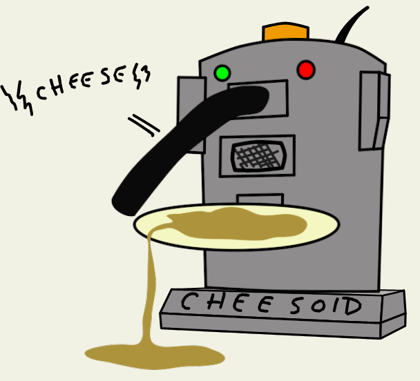

# Moho Power Launcher

> ⚠️ **AI-written code.** This program was created by CHEESOID, a working partnership between a human animator, Doug Craven, and Claude, an AI model made by Anthropic. Ideas were conceived and evaluated by Doug. **Every line of the launcher's code was written by Claude (AI)**, then directed and tested by hand by Doug Craven. Please read [AI-NOTICE.md](AI-NOTICE.md), and back up your Moho scripts folder before you first use it.

**Download:** [Moho-Power-Launcher-1.0.0.zip](https://github.com/iamthecrave/Moho-Power-Launcher/releases/download/v1.0.0/Moho-Power-Launcher-1.0.0.zip) · [how to install](#installing)

**Watch it in action:**

<!-- video here -->

## What It Does

<!-- your text here -->

## Features

<!-- your text here -->

## Requirements
- Moho Pro 14 on Windows. Mac is untested.

## Installing
1. Download the zip and unzip it (right-click > **Extract All**).
2. Double-click **Install Moho Power Launcher**.
3. If Windows says "Windows protected your PC", click **More info**, then **Run anyway**.
4. Check the three places it found, then click **Install**.

To remove it: Start menu > **Moho Power Launcher** > **Uninstall Moho Power Launcher**. Your script library and your own scripts are kept.

## Meet Cheesoid

Moho Power Launcher is made by **Cheesoid**, a team of two:
- **Doug Craven**, who designed it, directed it and tested every feature by hand in Moho.
- **Claude**, an AI model made by Anthropic, who wrote all of the code.

Contact: [mohovibecoding@gmail.com](mailto:mohovibecoding@gmail.com)

Also from Cheesoid: [Moho Flipbook](https://github.com/iamthecrave/Moho-Flipbook).

## Licence
PolyForm Noncommercial 1.0.0: use it, change it or share it for any noncommercial purpose. Selling it, or using it in a paid product or service, is not allowed. See [LICENSE](LICENSE).
